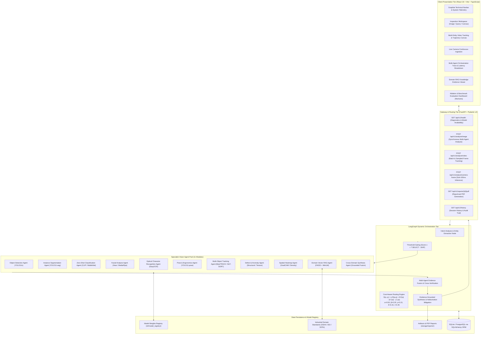
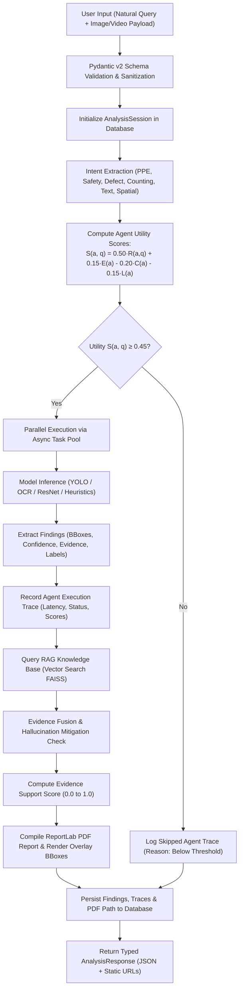
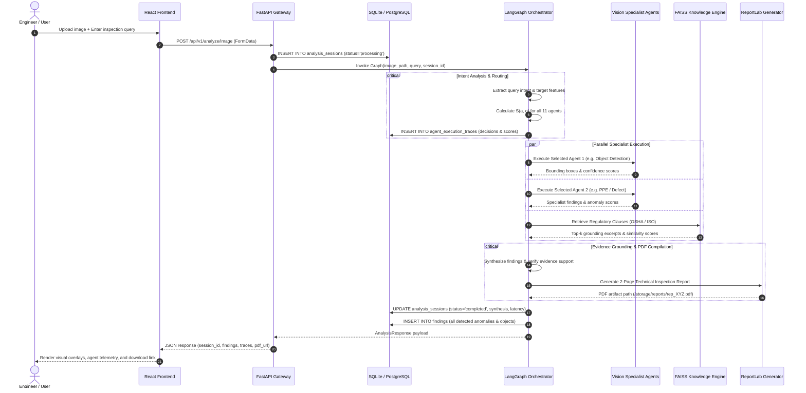

# VisionIQ: System Architecture, Data-Flow & Sequence Specifications

**Project Title:** VisionIQ: An Adaptive Multi-Agent Vision Intelligence Framework with Dynamic Orchestration and Cost-Aware Query Routing  
**Academic Evaluation:** BE CSE Final Year Project (Course 23CSP701), Anna University  
**Target Publication:** IEEE Access  

---

## 1. Multi-Tier Framework Architecture

VisionIQ is architected as an adaptive, multi-tier intelligence system decoupling query understanding, cost-aware dispatch, parallel specialist execution, and evidence-grounded synthesis.

---

## 2. End-to-End Data-Flow Architecture

---

## 3. Dynamic Orchestration Sequence Diagram

---

## 4. Mathematical Grounding & Routing Formulation

The dynamic orchestration routing score for an agent $a \in \mathcal{A}$ given query $q$ is defined as:

$$S(a, q) = \alpha R(a, q) + \delta E(a) - \beta C(a) - \gamma L(a)$$

Where:
- $R(a, q) \in [0, 1]$ represents the semantic query-to-agent relevance.
- $E(a) \in [0, 1]$ represents the agent's historical evidence capability.
- $C(a) \in [0, 1]$ represents the normalized compute cost.
- $L(a) \in [0, 1]$ represents the normalized latency.
- Calibrated weights: $\alpha = 0.50$, $\beta = 0.20$, $\gamma = 0.15$, $\delta = 0.15$, satisfying $\sum \text{weights} = 1.0$.
- Gating threshold: $\tau = 0.45$. An agent is activated if and only if $S(a, q) \ge \tau$.
