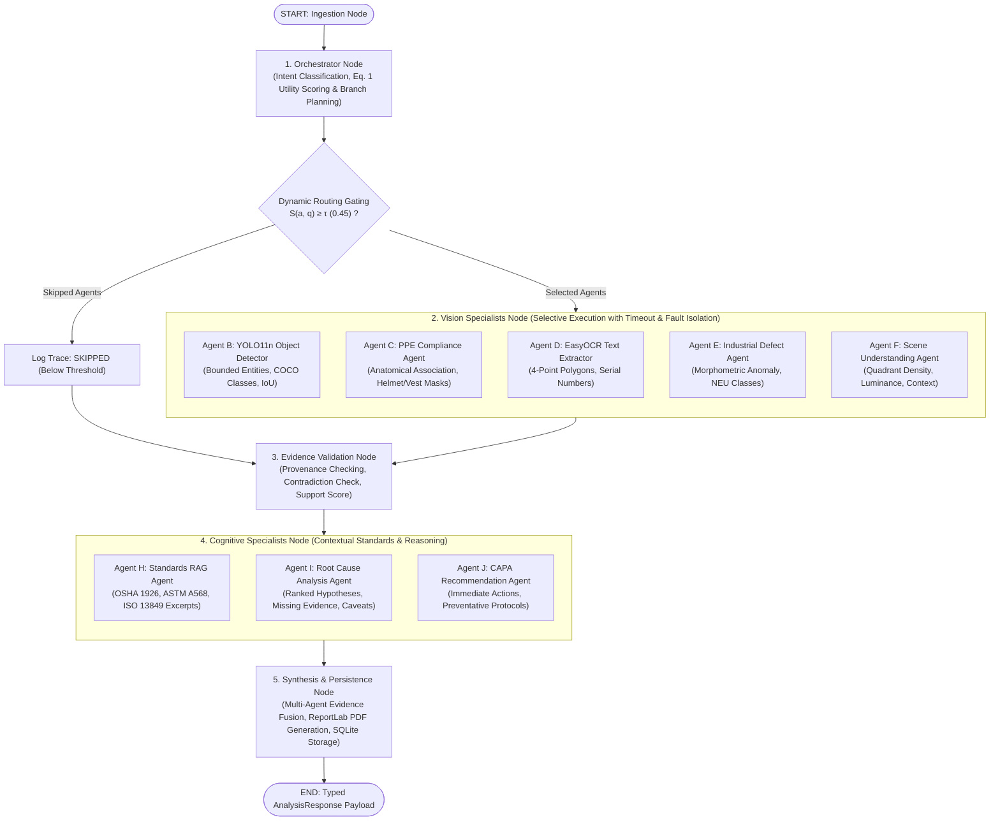

# VisionIQ: Adaptive Orchestration StateGraph & Dynamic Routing Specification

**Project Title:** VisionIQ: An Adaptive Multi-Agent Vision Intelligence Framework with Dynamic Orchestration and Cost-Aware Query Routing  
**Module:** LangGraph StateGraph Dynamic Orchestrator (Phase 2)  
**Target Publication:** IEEE Access  

---

## 1. LangGraph StateGraph Architecture

The orchestration engine coordinates intent classification, multi-criteria cost-aware routing (Eq. 1), selective vision agent execution, evidence cross-validation, and multi-agent synthesis.

---

## 2. Dynamic Routing Formulation & Calibrated Weights

For an agent $a \in \mathcal{A}$ and query $q$, the utility routing score is evaluated as:

$$S(a, q) = \alpha R(a, q) + \delta E(a) - \beta C(a) - \gamma L(a)$$

Where:
- $R(a, q) \in [0, 1]$ represents the semantic relevance between query $q$ and specialist agent $a$.
- $E(a) \in [0, 1]$ represents the agent's expected evidence capability.
- $C(a) \in [0, 1]$ represents normalized computational cost (FLOPs / memory overhead).
- $L(a) \in [0, 1]$ represents normalized expected latency.

### Operating Parameters:
- $\alpha = 0.50$ (Relevance weight)
- $\beta = 0.20$ (Cost penalty weight)
- $\gamma = 0.15$ (Latency penalty weight)
- $\delta = 0.15$ (Evidence capability weight)
- $\tau = 0.45$ (Operating selection threshold)
- $\sum (\alpha, \beta, \gamma, \delta) = 1.00$

### Selection Logic:
$$\text{Decision}(a) = \begin{cases} 
\text{SELECTED}, & \text{if } S(a, q) \ge \tau \\
\text{MANDATORY\_DEPENDENCY}, & \text{if activated by structural dependency rules} \\
\text{FALLBACK}, & \text{if rescued by minimum sufficient evidence constraint} \\
\text{SKIPPED}, & \text{otherwise}
\end{cases}$$

---

## 3. Mandatory Dependency Resolution Rules

1. **PPE Compliance Agent Dependency**: If `ppe` is selected, `object` is added as `MANDATORY_DEPENDENCY` to ensure anatomical person-level spatial bounding.
2. **Defect Inspection Dependency**: If `defect` is selected, `object` is added as `MANDATORY_DEPENDENCY` for object-bounded structural localization.
3. **Root Cause Analysis Dependency**: If `rca` is selected, at least one perceptual agent (`object`, `defect`, `ocr`, `ppe`) must be active as an observational ground.
4. **CAPA Recommendation Dependency**: If `recommendation` is selected, `rca`, `defect`, or `ppe` must be active to anchor actionable corrective protocols.
5. **Minimum Sufficient Evidence Fallback**: If no perceptual agent meets threshold $\tau$, deterministic fallback activates `object` and `scene` to guarantee an observational anchor.
6. **Provenance Validation Rule**: Whenever any perceptual vision specialist is active, `evidence_validation` is dispatched to compute the Evidence Support Score and mitigate hallucinations.

---

## 4. Benchmark Query Routing Behavior

| Benchmark Query | Detected Intent | Selected Agents | Skipped Agents | Justification |
| :--- | :--- | :--- | :--- | :--- |
| **A. "Read the serial number on this machine."** | `ocr_text_extraction` | `ocr`, `evidence_validation` | `defect`, `ppe`, `scene`, `rca`, `rag`, `recommendation` | High OCR relevance ($R=0.98, S=0.490 \ge 0.45$). Defect and PPE skipped to avoid wasteful compute. |
| **B. "Count all visible people."** | `object_counting_detection` | `object`, `evidence_validation` | `ocr`, `defect`, `ppe`, `scene`, `rag`, `rca`, `recommendation` | Object detection ($S=0.561 \ge 0.45$). OCR and Defect explicitly skipped ($S < 0.10$). |
| **C. "Check whether workers are wearing helmets."** | `ppe_safety_compliance` | `object`, `ppe`, `evidence_validation`, `recommendation` | `ocr`, `defect`, `scene` | PPE specialist ($S=0.552$) triggers person detector; recommendation formulations attached. |
| **D. "Locate cracks or scratches on this metal surface."** | `defect_inspection` | `object`, `defect`, `evidence_validation`, `rca`, `recommendation` | `ocr`, `ppe`, `scene` | Defect agent ($S=0.495$) triggers structural object anchor, RCA causal reasoning, and ASTM standards. |
| **E. "Describe the scene and explain the possible damage."** | `combined_scene_and_defect` | `object`, `defect`, `scene`, `evidence_validation`, `rca` | `ocr`, `ppe` | Multi-faceted query activates scene context ($S=0.565$) and defect inspector ($S=0.455$) simultaneously. |
