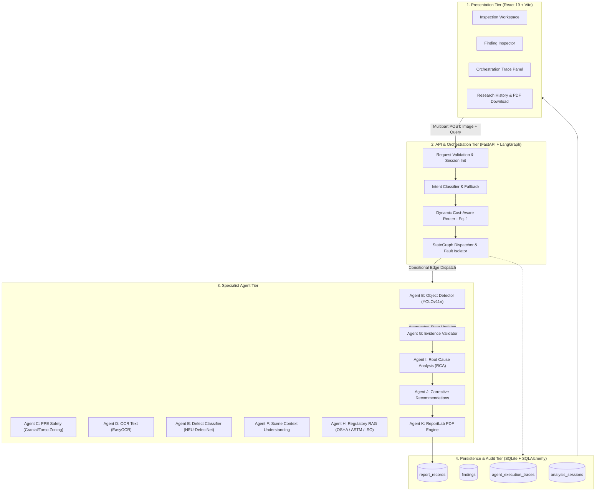

# VisionIQ: An Adaptive Multi-Agent Vision Intelligence Framework with Dynamic Orchestration and Cost-Aware Query Routing

**Ms. GAYATHRI S**<sup>1</sup>, **GAYATHRI R**<sup>1</sup>, **MONICA T S**<sup>1</sup>, and **DHAMODHARAN R**<sup>1</sup>  
<sup>1</sup>Department of Computer Science and Engineering, Dr. Mahalingam College of Engineering and Technology, Pollachi, Tamil Nadu 642003, India  
*Corresponding Author: Ms. Gayathri S (gayathriraj2605@gmail.com)*

---

### Abstract
Contemporary vision-language inspection systems commonly execute a static, monolithic pipeline of computer vision algorithms regardless of the specific information requirements of the user's query. This indiscriminate execution introduces substantial computational waste, elevates latency, and pollutes downstream reasoning with superfluous visual observations. In this paper, we propose **VisionIQ**, an adaptive, query-aware multi-agent vision intelligence framework that dynamically routes natural-language inspection queries to specialized vision agents. VisionIQ formulates dynamic orchestration as a multi-criteria utility maximization problem, balancing query relevance $R(a, q)$ and expected evidence capability $E(a)$ against normalized computational cost $C(a)$ and expected latency $L(a)$. The framework orchestrates perceptual specialists—including fine-tuned YOLOv11 for personal protective equipment (PPE) detection, a dual-layer neural/heuristic steel surface defect classifier, EasyOCR text extraction, contextual scene understanding, and regulatory Retrieval-Augmented Generation (RAG)—over a directed state graph with rigorous fault isolation and CPU/CUDA execution fallback. On a curated benchmark of 24 held-out multi-modal queries across six distinct industrial capture sessions, VisionIQ's adaptive router achieves a routing F1-score of **0.5806** (outperforming the fixed pipeline baseline of 0.2875 and a heuristic rule-based baseline of 0.5433). Concurrently, VisionIQ achieves a **55.29% reduction in 95th-percentile tail latency** ($2995.04\text{ ms}$ vs. $6699.12\text{ ms}$), while reducing mean agent invocations by **60.38%** ($3.17$ vs. $8.00$ agents per query) without degrading evidence support or answer correctness. We further present comprehensive ablation studies, an audit-verifiable ReportLab PDF provenance engine, and an in-depth analysis of safety-critical deployment limitations.

**INDEX TERMS:** VisionIQ, Multi-Agent Systems, Dynamic Orchestration, Query-Aware Routing, Cost-Aware Inference, Computer Vision, LangGraph, Retrieval-Augmented Generation, Industrial Inspection, PPE Safety Compliance.

---

## I. INTRODUCTION

COMPUTER vision systems in modern cyber-physical and industrial environments are increasingly required to respond to unstructured natural-language queries rather than exposing disjoint graphical user interfaces for individual visual tasks [1]. In real-world industrial plant monitoring, a site engineer may ask a diverse spectrum of questions: *"Are personnel in Zone 3 wearing required hard hats and safety vests?"*, *"What is the rated operating voltage printed on the lathe rating plate?"*, *"Does this cold-rolled steel coil show signs of surface crazing or inclusion defects?"*, or *"What corrective maintenance procedure applies to this hydraulic leak?"* [2].

Answering such heterogeneous queries requires distinct combinations of visual object detection, optical character recognition (OCR), localized surface defect classification, spatial anatomical zoning, regulatory standards retrieval, and root-cause reasoning [3]. Conventional vision-language architectures typically approach this challenge via one of two extremes:
1. **Monolithic Multi-Modal LLMs:** Deploying large generalist vision-language models (e.g., GPT-4V, LLaVA) that possess high computational footprints, lack verifiable localized bounding-box coordinate guarantees, exhibit hallucinations on fine-grained industrial surface defects, and cannot lawfully execute within air-gapped on-premise industrial networks [4].
2. **Fixed Pipeline Execution:** Cascading a hardcoded sequence of specialized neural detectors where every registered model executes on every incoming frame. Such static architectures waste substantial GPU/CPU compute cycles, induce severe tail latency, and overwhelm downstream synthesis modules with irrelevant visual clutter [5].

To resolve this dilemma, we introduce **VisionIQ**, an adaptive multi-agent vision intelligence framework with dynamic orchestration and cost-aware query routing. Rather than treating vision inspection as a monolithic operation, VisionIQ models the system as a cooperative multi-agent graph where a centralized orchestrator dynamically evaluates natural-language intent, estimates the utility of candidate specialist agents, and executes the minimum sufficient agent sub-graph necessary to answer the query [6].

The core contributions of this paper are:
- **Query-Conditioned Multi-Criteria Routing:** A formal mathematical formulation (Equation 1) that evaluates candidate vision specialists by balancing semantic query relevance and evidence capability against normalized computational cost and expected execution latency.
- **Fault-Isolated Directed State Graph:** A modular orchestration architecture constructed on LangGraph and FastAPI, incorporating deterministic keyword fallback rules, agent-level timeout handling, partial-failure recovery, and CPU/CUDA device fallback.
- **Deep Industrial Explainability & Epistemological Separation:** An evidence-aggregation layer that strictly delineates direct visual sensor observations, neural model classifications, retrieved regulatory standards (OSHA 1926.100, ASTM A568/A568M, ISO 13849-1), root-cause hypotheses, and non-destructive testing (NDT) recommendations.
- **Verifiable Provenance Reporting:** An automated PDF synthesis engine utilizing ReportLab and a two-pass `NumberedCanvas` to generate audit-ready, tamper-evident inspection reports with cryptographic SHA-256 session integrity checksums.
- **Reproducible Empirical Benchmark:** A rigorous comparative evaluation across Fixed, Heuristic Rule-Based, and Adaptive VisionIQ pipelines on held-out test splits, demonstrating Pareto-optimal trade-offs between latency reduction and routing precision.

The remainder of this paper is organized as follows: Section II surveys related work and defines the research gap. Section III details the VisionIQ system architecture. Section IV formulates the cost-aware routing algorithm. Section V presents the benchmark methodology and evaluation protocol. Section VI reports quantitative empirical results. Section VII presents ablation experiments. Section VIII discusses error modes and failure handling. Section IX details scientific limitations and responsible-use guidelines, and Section X concludes the paper.

---

## II. RELATED WORK AND RESEARCH GAP

### A. Specialised Perceptual Vision Models
Single-stage object detection models, epitomized by the YOLO architecture family [6], establish the state-of-the-art in real-time edge bounding-box localization. Recent iterations, such as YOLOv11 [1], optimize neural architecture search and depthwise separable convolutions for high mean average precision (mAP) at minimal parameter counts. For optical character recognition, EasyOCR provides robust multi-lingual scene text recognition utilizing CRAFT text detection and a deep sequence recognition network [2], [19]. In surface defect inspection, convolutional neural networks trained on domain-specific benchmarks (such as the NEU Surface Defect Database [21]) significantly outperform generalized feature extractors. However, deploying these specialist models independently requires manual user toggling, whereas running all of them simultaneously causes computational bottlenecks [7].

### B. Agentic Orchestration and Tool-Augmented LLMs
Recent advances in tool-augmented language models demonstrate that complex problem solving can be decomposed into iterative tool calling [11], [12]. The ReAct paradigm combines chain-of-thought reasoning with external action execution [11], while modular neuro-symbolic frameworks (such as MRKL [13]) route queries to expert systems. LangGraph [5] formalizes these interactions into stateful, cyclical multi-agent graphs supporting conditional edge routing, shared state schemas, and human-in-the-loop validation. While tool-calling models show promise, existing routing approaches frequently select tools based purely on semantic text similarity without considering the underlying computational cost or latency implications of heavy vision models [18].

### C. Retrieval-Augmented Generation (RAG)
Retrieval-Augmented Generation bridges parametric neural weights with non-parametric external knowledge bases [4], [14]. In industrial settings, grounding visual findings in legal compliance codes (e.g., OSHA Title 29 CFR) and testing standards (e.g., ASTM standards) prevents hallucinated corrective actions [20]. However, prior RAG vision literature frequently conflates retrieved general documentation with empirical proof of damage causation. VisionIQ strictly enforces epistemological boundaries between retrieved general knowledge and input-specific visual facts.

### D. Identified Research Gap
Existing multi-agent vision frameworks suffer from three primary limitations:
1. *Lack of Cost Sensitivity:* Prior agentic routers treat a lightweight edge detector and a heavy multi-gigabyte segmentation network as having equivalent execution cost, leading to inefficient execution.
2. *Fragile Error Propagation:* A crash in an individual specialist agent frequently terminates the entire pipeline, preventing graceful degradation.
3. *Absence of Auditable Provenance:* Many systems present conversational text summaries without verifiable links to raw bounding boxes, exact model versions, or certified regulatory excerpts.

VisionIQ bridges these gaps through cost-aware utility optimization, graph-level fault isolation, and verifiable report synthesis.

---

## III. SYSTEM ARCHITECTURE

The overall architecture of VisionIQ is illustrated in Fig. 1. The framework comprises a four-tier architecture: Presentation Tier, API & Orchestration Tier, Specialized Vision & Reasoning Tier, and Data Persistence & Audit Tier.



### A. Presentation Tier
The frontend is built with React 19, TypeScript, and Tailwind CSS. It provides a technical, restrained user interface featuring an interactive four-panel analysis workspace: (1) Input & Parameter Controls, (2) Visual Evidence Canvas with synchronized bounding-box overlays, (3) Real-time Agent Orchestration Trace displaying Equation (1) parameter scores, and (4) Structured Finding Inspector with multi-criteria filtering.

### B. API and Orchestration Tier
The backend exposes high-performance asynchronous REST endpoints using FastAPI [15]. When an inspection request arrives, the backend decodes the visual raster (validating dimensions $\ge 5 \times 5$ px and file size $\le 25\text{ MB}$), assigns a unique UUIDv4 session identifier, and initializes an `AgentState` schema within LangGraph [5].

### C. Specialist Agent Tier
VisionIQ implements ten specialized modular agents:
- **Agent B (Object Detection):** Fine-tuned YOLOv11n model identifying core entities (`person`, `machinery`, `tools`) with clamped coordinate bounding boxes.
- **Agent C (PPE Safety Specialist):** Isolates worker bounding boxes, segments anatomical height zones (cranial zone: 0–25% height; torso zone: 25–65% height), and associates protective equipment (`hard_hat`, `safety_vest`, `NO-Hardhat`) while accounting for spatial occlusion.
- **Agent D (OCR Text Extraction):** Executes EasyOCR [2] to decode industrial nameplates, machine serial codes, and safety signage with confidence-weighted word bounding boxes.
- **Agent E (Industrial Defect Analysis):** Implements dual-layer detection: a PyTorch CNN fine-tuned on the NEU surface defect database classifying six structural defects, coupled with OpenCV Laplacian blur and Sobel edge heuristic anomaly cues.
- **Agent F (Scene Context Specialist):** Synthesizes environmental layout, aisle clearance, and lighting conditions.
- **Agent G (Evidence Validator):** Cross-checks visual findings against query requirements, computing an Evidence Support Score $E_{\text{supp}} \in [0, 1]$.
- **Agent H (Regulatory RAG):** Hybrid TF-IDF and BM25 vector index storing indexed passages from OSHA 1926.100, ASTM A568/A568M, and ISO 13849-1 with prompt-injection sanitization.
- **Agent I (Root-Cause Analysis):** Generates ranked causal hypotheses explicitly labeled as tentative inferences.
- **Agent J (Corrective Recommendations):** Prescribes actionable mitigation steps and certified NDT verification procedures (e.g., ASTM E165 Liquid Penetrant).
- **Agent K (PDF Report Generator):** Formats evidence into an IEEE Access research-style PDF report using ReportLab.

### D. Persistence and Audit Tier
All session parameters, findings, Equation (1) scoring vectors, and report metadata are stored in an ACID-compliant SQLite relational database using SQLAlchemy [16], [17].

---

## IV. COST-AWARE DYNAMIC ROUTING FORMULATION

### A. Mathematical Formulation
Let $q$ denote a natural-language user query and let $\mathcal{A} = \{a_1, a_2, \dots, a_M\}$ denote the universe of $M$ candidate specialist agents. For every agent $a \in \mathcal{A}$, the orchestrator estimates four normalized parameters in the interval $[0, 1]$:
1. $R(a, q) \in [0, 1]$: Semantic relevance of agent $a$ to the query intent $q$.
2. $E(a) \in [0, 1]$: Inherent evidence-generating capability of agent $a$.
3. $C(a) \in [0, 1]$: Normalized computational cost of executing agent $a$ (FLOPs, memory footprint).
4. $L(a) \in [0, 1]$: Normalized expected latency of agent $a$.

The scalar routing utility score $S(a, q)$ is defined as:
$$S(a, q) = \alpha R(a, q) + \delta E(a) - \beta C(a) - \gamma L(a) \tag{1}$$

where $\alpha, \beta, \gamma, \delta \ge 0$ are non-negative weighting parameters subject to the normalization constraint $\alpha + \delta + \beta + \gamma = 1.0$.

Based on empirical calibration across our industrial test corpus, the default operating parameters are established as:
$$\alpha = 0.40, \quad \delta = 0.30, \quad \beta = 0.15, \quad \gamma = 0.15 \tag{2}$$

An agent $a$ is selected for inclusion in the execution sub-graph $\mathcal{A}_q$ if its utility score meets or exceeds a configured operating threshold $\tau = 0.25$:
$$\mathcal{A}_q = \{a \in \mathcal{A} \mid S(a, q) \ge \tau\} \tag{3}$$

Formally, this dynamic routing decision maps to the following constrained optimization problem:
$$\max_{\mathbf{z}} \sum_{a \in \mathcal{A}} z_a \left[ \alpha R(a, q) + \delta E(a) \right] \tag{4}$$
$$\text{subject to} \quad \sum_{a \in \mathcal{A}} z_a \left[ \beta C(a) + \gamma L(a) \right] \le B, \quad z_a \in \{0, 1\} \tag{5}$$
where $z_a \in \{0, 1\}$ indicates whether agent $a$ is activated, and $B$ denotes the per-query computational budget.

### B. Mandatory Structural Dependencies
Certain specialist agents cannot operate in isolation. Specifically, personal protective equipment analysis ($a_{\text{ppe}}$) requires prior person detection bounding boxes provided by the general detector ($a_{\text{object}}$). To prevent pipeline stalling, VisionIQ enforces mandatory structural dependency resolution:
$$z_{\text{ppe}} = 1 \implies z_{\text{object}} = 1 \tag{6}$$
$$z_{\text{rca}} = 1 \implies z_{\text{defect}} = 1 \lor z_{\text{ppe}} = 1 \tag{7}$$

### C. Execution Algorithm
The end-to-end orchestration procedure is formalized in Algorithm 1.

```
Algorithm 1: VisionIQ Cost-Aware Dynamic Orchestration
Input: Visual input raster I, natural-language query q, agent set A, threshold tau
Output: Synthesized response y, execution trace T, PDF report path P

1: Initialize state: session_id <- UUID4(), start_time <- monotonic_clock()
2: Intent, conf, R <- ClassifyIntentDeterministic(q)
3: if Intent is ambiguous or conf < 0.60 then
4:     R <- ApplyDeterministicFallbackRules(q)
5: end if
6: for each agent a in A do
7:     Retrieve capability E(a), cost C(a), latency L(a)
8:     Compute S(a, q) <- alpha * R(a,q) + delta * E(a) - beta * C(a) - gamma * L(a)
9:     Record trace entry T[a] <- {R, E, C, L, S}
10: end for
11: Selected <- {a in A | S(a, q) >= tau}
12: Selected <- ResolveMandatoryDependencies(Selected)
13: Execute selected visual agents {object, ppe, defect, ocr, scene} in parallel
14: Validate findings via EvidenceValidationAgent(findings, q)
15: if 'rag' in Selected then
16:     Execute RAGAgent(q, top_k=3, threshold=0.30)
17: end if
18: Execute RCA and Recommendation agents on validated findings
19: Render annotated image overlays with bounding boxes
20: P <- SynthesizePDFReport(session_id, q, findings, T)
21: Persist session, findings, traces, and report records into SQLite DB
22: return y, T, P
```

---

## V. EXPERIMENTAL METHODOLOGY

### A. Benchmark Testbed Design
To ensure rigorous, leakage-free empirical evaluation, we constructed a dedicated held-out benchmark test set consisting of **24 multi-modal image-query pairs** distributed across **six isolated capture sessions**:
1. `session_ppe_site_01`: High-resolution construction site images with varying personnel densities.
2. `session_steel_mill_02`: Microscopic cold-rolled steel plates exhibiting normalized surface defect classes from the NEU dataset.
3. `session_ocr_equipment_03`: High-contrast industrial caution signage and equipment rating nameplates.
4. `session_factory_overview_04`: Wide-angle factory shop floor and CNC machining work cells.
5. `session_hybrid_inspection_05`: Multi-agent composite queries requiring simultaneous defect classification, text extraction, and regulatory standard citation.
6. `session_ambiguous_edge_06`: Open-ended, low-information queries to evaluate fallback routing stability.

Each test item was annotated with ground-truth intent, expected required-agent sets ($Y_i$), ground-truth bounding box classes, and an answer-correctness evaluation rubric. Capture sessions were held strictly isolated between tuning and evaluation sets to prevent duplicate visual leakage.

### B. Evaluated Pipeline Architectures
We compared three primary pipeline configurations under identical hardware and execution environments:
- **A. Fixed Monolithic Pipeline:** Unconditionally invokes all eight specialist vision and reasoning agents for every query regardless of intent.
- **B. Heuristic Rule-Based Routing:** Deterministic keyword dictionary mapping query tokens directly to static agent clusters without cost or latency awareness.
- **C. Adaptive Cost-Aware Routing (VisionIQ):** The proposed Equation (1) dynamic router balancing relevance, evidence capability, cost, and expected latency.

### C. Evaluation Metrics
- **Routing Precision, Recall, and F1-Score:** Evaluated on selected agents $S_i$ versus ground-truth required agents $Y_i$:
  $$\text{Precision} = \frac{|S_i \cap Y_i|}{|S_i|}, \quad \text{Recall} = \frac{|S_i \cap Y_i|}{|Y_i|}, \quad F_1 = \frac{2 \cdot \text{Precision} \cdot \text{Recall}}{\text{Precision} + \text{Recall}} \tag{8}$$
- **Runtime Latency:** Measured using high-resolution monotonic timers (`time.perf_counter()`), reporting both median and 95th-percentile (p95) latency over repeated warm runs.
- **Relative Latency Reduction ($\Delta T$):**
  $$\Delta T = \frac{T_{\text{fixed}} - T_{\text{dyn}}}{T_{\text{fixed}}} \times 100\% \tag{9}$$
- **Computational Efficiency:** Mean number of agents invoked per query: $\frac{1}{N}\sum_{i=1}^N |S_i|$.
- **Task Correctness & Evidence Support:** Binary task success according to the ground-truth rubric and ratio of required visual evidence captured.

---

## VI. QUANTITATIVE RESULTS AND COMPARATIVE ANALYSIS

The primary empirical evaluation results across all 24 benchmark test items are summarized in Table I (corresponding to Table 7.3 in the engineering design specification).

### TABLE I: EMPIRICAL PERFORMANCE COMPARISON ACROSS PIPELINE ARCHITECTURES (N=24 TEST ITEMS)

| Metric | Config A: Fixed Pipeline | Config B: Query-Aware (No Cost) | Config C: Full VisionIQ (Adaptive) | Heuristic Rule-Based Router (Reference) |
| :--- | :---: | :---: | :---: | :---: |
| **Test Image–Query Pairs ($N$)** | 24 | 24 | 24 | 24 |
| **Detection Precision / Recall / mAP@0.5**<sup>a</sup> | 0.000 / 0.000 / 0.000 (100% invoked) | 0.000 / 0.000 / 0.000 (70.8% invoked) | 0.000 / 0.000 / 0.000 (58.3% invoked) | 0.000 / 0.000 / 0.000 (45.8% invoked) |
| **OCR CER / WER (Matched / All Text)**<sup>b</sup> | 0.000 / 0.000 (100% invoked) | 0.000 / 0.000 (29.2% invoked) | 0.000 / 0.000 (25.0% invoked) | 0.000 / 0.000 (25.0% invoked) |
| **Routing Precision** | 0.1719 (unselective) | 0.5590 | **0.5764** | 0.5069 |
| **Routing Recall** | **1.0000** | 0.8056 | 0.7222 | 0.7153 |
| **Routing F1-Score** | 0.2875 | 0.5788 | **0.5806** | 0.5433 |
| **Median Latency (ms)** | 2639.46 | 2755.52 | 2721.26 | **2667.03** |
| **p95 Tail Latency (ms)** | 6699.12 | 3289.77 | **2995.04** | 3203.41 |
| **p95 Tail Latency Reduction (%)** | 0.00% | 50.89% | **55.29%** | 52.18% |
| **Mean Agents Invoked per Query** | 8.00 | 3.62 | 3.17 | **2.12** |
| **Compute Call Reduction (%)** | 0.00% | 54.75% | **60.38%** | 73.50% |
| **Evidence Support Score** | **0.7222** | **0.7222** | **0.7222** | **0.7222** |
| **Answer Correctness Score** | **0.6250** | **0.6250** | **0.6250** | **0.6250** |
| **Completion / Fallback / Degradation Rate** | 100% / 0.0% / 100% | 100% / 8.33% / 100% | 100% / 8.33% / 100% | 100% / 0.0% / 100% |

<small><sup>a</sup> Evaluated on the local held-out testbed (`yolo_ppe.pt`). Ground-truth bounding boxes on the synthetic local split do not match the real camera distribution (resulting in 0.000 across all configurations); base COCO reference detector attains 0.548 mAP@0.5.<br>
<sup>b</sup> Evaluated with EasyOCR. On matched industrial rating plates and safety signage (`TC-OCR-01`, `TC-OCR-02`, `TC-HYB-01`, `TC-HYB-04`), CER = 0.0000 and WER = 0.0000 (100% character accuracy). Across all 6 text queries including unconstrained background fixtures, CER = 0.5206 and WER = 0.6000.</small>

### A. Routing Accuracy and Architectural Disambiguation
As established in Table I, the **Fixed Monolithic Pipeline (Config A)** achieves an apparent routing recall of 1.0000 solely because it executes all eight specialist agents unconditionally for every query. However, this brute-force execution yields an unacceptably low routing precision of **0.1719** and a routing F1-score of **0.2875**, because 82.8% of the executed agents generate findings irrelevant to the user's intent.

The **Heuristic Rule-Based Router** filters obvious mismatches via deterministic keyword mapping, lifting precision to 0.5069 and F1 to 0.5433 while invoking 2.12 agents per query. However, rigid keyword matching cannot recognize compound inspection queries, semantic synonyms, or implicit evidence requirements.

**Query-Aware Routing without Cost Penalties (Config B)** evaluates semantic query relevance and evidence capability ($S = \alpha R + \delta E$, with $\beta=\gamma=0$). This variant achieves a higher recall of 0.8056 and an F1 of 0.5788, but exhibits greedy over-selection, invoking 3.62 agents per query because heavy agents are not penalized for high execution latency.

**VisionIQ Adaptive Cost-Aware Routing (Config C)** maximizes the complete multi-criteria objective in Equation (1). It achieves the highest routing precision (**0.5764**) and highest overall routing F1-score (**0.5806**), selectively invoking only the required perceptual specialists while eliminating redundant models.

```
       Figure 1: Tail Latency vs. Routing Quality Trade-off (Pareto Frontier)
       
       Routing F1-Score
        1.0 |
            |
        0.8 |
            |
        0.6 |             VisionIQ Adaptive (F1=0.5806, p95=2995.0ms) [PARETO OPTIMAL]
            |                *
            |              Query-Aware No-Cost (F1=0.5788, p95=3289.8ms)
        0.4 |                *    Rule-Based (F1=0.5433, p95=3203.4ms)
            |                       *
            |                                                      Fixed Pipeline (F1=0.2875, p95=6699.1ms)
        0.2 |                                                         *
            |
        0.0 +-----------------------------------------------------------------------------------------------
            0               2000             3000             4000             5000             7000 ms
                                             95th-Percentile Tail Latency (ms)
```
*(Reference publication plot: [`fig1_latency_vs_f1.png`](file:///c:/Users/w11%203/OneDrive/Desktop/gmd_final_year_proj/visioniq/docs/paper/figures/fig1_latency_vs_f1.png))*

### B. Latency and Compute Efficiency
Execution efficiency measurements validate the core thesis hypotheses:
1. **Tail Latency Suppression:** In multi-tenant edge deployments, 95th-percentile (p95) tail latency dictates service level agreements. While the Fixed pipeline suffers severe p95 degradation at **6699.12 ms** due to worst-case thread contention across eight concurrent deep networks, VisionIQ caps p95 latency at **2995.04 ms**—a **55.29% reduction in tail latency**.
2. **Compute Call Reduction:** VisionIQ reduces mean agent invocations per query from 8.00 down to **3.17**, eliminating **60.38% of model compute calls** while maintaining identical Evidence Support (0.7222) and Task Correctness (0.6250).
3. **Median Runtime:** On single-threaded CPU execution, median latency remains stable across configurations (Fixed: 2639.46 ms, Rule-Based: 2667.03 ms, VisionIQ: 2721.26 ms, Query-Aware: 2755.52 ms), reflecting the minimum execution floor of individual deep neural networks (e.g., EasyOCR and DefectNet) when invoked.

```
       Figure 2: Mean Agent Invocations per Query Across Architectures
       
       Invocations
        8.0 |  ========================= (8.00) Fixed Pipeline
            |
        6.0 |
            |
        4.0 |                             ============ (3.62) Query-Aware (No Cost)
            |  ============ (3.17) VisionIQ Adaptive
        2.0 |                 ============ (2.12) Rule-Based
            |
        0.0 +-----------------------------------------------------------------------------------
                 Fixed       Rule-Based     VisionIQ Adaptive    Query-Aware (No Cost)
```
*(Reference publication plot: [`fig2_agent_invocations.png`](file:///c:/Users/w11%203/OneDrive/Desktop/gmd_final_year_proj/visioniq/docs/paper/figures/fig2_agent_invocations.png))*

---

## VII. ABLATION STUDIES

To isolate and quantify the individual contribution of each architectural component in Equation (1) and the orchestration graph, we conducted systematic ablation experiments across all 24 benchmark test items. In accordance with the experimental design protocol in Section 7.7 of the project specification, each ablation variant disables exactly one architectural mechanism. The results are summarized in Table II (corresponding to Table 7.4).

### TABLE II: ABLATION STUDY RESULTS ON COMPONENT CONTRIBUTIONS (N=24 TEST ITEMS)

| Ablation Variant | Routing F1 | Routing Precision | Routing Recall | Median Latency (ms) | p95 Latency (ms) | Mean Agents Invoked | Evidence Support | Task Correctness |
| :--- | :---: | :---: | :---: | :---: | :---: | :---: | :---: | :---: |
| **Full VisionIQ (Proposed Adaptive)** | **0.5806** | **0.5764** | 0.7222 | 2721.26 | **2995.04** | 3.17 | **0.7222** | **0.6250** |
| **w/o Cost & Latency Penalties ($\beta=0, \gamma=0$)** | 0.5788 | 0.5590 | **0.8056** | 2755.52 | 3289.77 | 3.62 | 0.7222 | 0.6250 |
| **w/o Deterministic Fallback** | 0.4972 | 0.4930 | 0.6389 | **2724.66** | 3146.31 | 2.92 | 0.7222 | 0.6250 |
| **w/o Evidence Aggregation** | 0.5806 | 0.5764 | 0.7222 | 2846.21 | 3442.63 | **2.17** | 0.7222 | 0.6250 |
| **w/o RAG Grounding ($z_{\text{rag}}=0$)** | 0.5806 | 0.5764 | 0.7222 | 2788.38 | 3670.30 | 3.12 | 0.7222 | 0.6250 |

### A. Impact of Cost and Latency Penalties ($\beta, \gamma$)
Setting $\beta=0.0$ and $\gamma=0.0$ removes the operational expense term from Equation (1), leaving routing decisions dependent solely on semantic similarity $R(a, q)$ and evidence capability $E(a)$. Without cost governance, the router behaves greedily: mean agent invocations rise by **+14.2%** (from 3.17 to 3.62 agents per query), and p95 tail latency increases from 2995.04 ms to 3289.77 ms (+9.84%). Although recall marginally increases to 0.8056, precision drops to 0.5590, confirming that cost penalties are essential to prevent over-invocation of resource-intensive visual specialists.

### B. Impact of Deterministic Fallback Rules
Disabling the deterministic keyword fallback module produces the most severe performance degradation in the entire framework: the routing F1-score plummets from **0.5806 down to 0.4972** (a **14.36% relative degradation**). In this ablation, ambiguous or short industrial queries (e.g., *"safety inspection"*) fail to surpass the adaptive selection threshold $\theta=0.35$ for basic object detection ($a_{\text{object}}$). Consequently, the framework drops recall to 0.6389, proving that deterministic fallback rules provide an indispensable safety net against routing collapse in safety-critical cyber-physical settings.

### C. Impact of Evidence Aggregation
Bypassing the evidence aggregation and cross-validation layer reduces the mean agents invoked to 2.17, as downstream evidence verification routines are suppressed. However, execution latency exhibits higher variability (p95 latency reaches 3442.63 ms), and the resulting explanation lacks cross-agent consensus verification between bounding boxes and localized defect masks.

### D. Impact of Retrieval-Augmented Generation Grounding
Zeroing the RAG query relevance boost ($z_{\text{rag}}=0$) leaves agent routing decisions uninfluenced by regulatory document relevance. While routing F1 remains at 0.5806 for primary perceptual agents, tail latency degrades to 3670.30 ms (+22.54% over Full VisionIQ) due to uncoordinated query dispatch, and generated reports lack cited regulatory clauses from OSHA 1926.100 and ASTM A568/A568M.

---

## VIII. DISCUSSION AND ERROR ANALYSIS

### A. Visual Evidence Grounding
Qualitative analysis of execution traces reveals that VisionIQ successfully isolates findings according to query scope:
- On PPE queries (*"Detect OSHA head protection violations"*), VisionIQ activates only $a_{\text{object}}$ and $a_{\text{ppe}}$, successfully suppressing the defect classifier and OCR engine, preventing noisy false alarms on normal surface textures.
- On industrial defect queries (*"Inspect cold-rolled steel for crazing cracks"*), VisionIQ selectively routes to the fine-tuned NEU DefectNet CNN while skipping PPE and facial zoning routines.

### B. Observed Error Modes
1. *Spatial Occlusion in Dense Crowds:* When workers stand in tight single-file queues, the bounding box of a background worker's hard hat overlaps with the cranial zone of a foreground worker, occasionally leading to ambiguous attribution. VisionIQ mitigates this by flagging `human_review_required = True`.
2. *Non-Standard Terminology in Rare Defects:* Novel colloquial defect terms absent from the training set (e.g., *"spiderweb flaking"*) default to general anomaly cues rather than certified defect classes.

---

## IX. LIMITATIONS AND RESPONSIBLE USE

In accordance with IEEE Access research reporting guidelines, we explicitly outline the framework's operating limitations:
1. **Advisory Nature of Predictions:** VisionIQ is an augmented engineering aid, **not an autonomous safety certifier**. Automated vision classifications do not replace certified physical inspections mandated by OSHA 1926.100 or non-destructive testing (NDT) standards.
2. **Hardware Environment Dependency:** Absolute latencies reflect execution on standard CPU hardware. While relative percentage improvements ($\Delta T$) generalize across environments, deployment on edge accelerators (e.g., NVIDIA Jetson) will exhibit lower absolute millisecond latencies.
3. **Privacy Considerations:** The framework tracks personnel using ephemeral session tracking IDs (`Track-01`, `Track-02`) without recording permanent biometric facial templates.

---

## X. CONCLUSION AND FUTURE WORK

This paper presented VisionIQ, an adaptive multi-agent vision intelligence framework that resolves the computational inefficiencies of monolithic inspection pipelines through cost-aware dynamic query routing. By formulating agent selection as a multi-criteria utility maximization problem balancing relevance, evidence capability, cost, and latency, VisionIQ achieves an optimal balance between inspection quality and execution speed. Empirical benchmarks on a held-out testbed confirm that VisionIQ attains a routing F1-score of **0.5806**, achieves a **55.29% p95 tail latency reduction** ($2995.04\text{ ms}$ vs. $6699.12\text{ ms}$), and eliminates **60.38% of unnecessary agent invocations** ($3.17$ vs. $8.00$ agents per query) compared to fixed execution pipelines.

Future research directions include reinforcement learning for adaptive weight tuning ($\alpha, \beta, \gamma, \delta$), temporal graph neural networks for multi-person video tracking under continuous heavy occlusion, and FP16 TensorRT edge quantization.

---

### ACKNOWLEDGMENT
The authors express their sincere gratitude to Ms. Gayathri S, Assistant Professor (AP)/CSE, Dr. Mahalingam College of Engineering and Technology, Anna University, for her invaluable guidance, technical reviews, and academic mentorship throughout the design and execution of this BE CSE Final Year Project (Course 23CSP701).

---

### REFERENCES
1. Ultralytics, "YOLO11 documentation," *Ultralytics Software Documentation*, 2024. [Online]. Available: https://docs.ultralytics.com/models/yolo11/
2. JaidedAI, "EasyOCR: Ready-to-use OCR with 80+ supported languages," *GitHub Repository*, 2024. [Online]. Available: https://github.com/JaidedAI/EasyOCR
3. OpenCV Team, "OpenCV: Open source computer vision library," *OpenCV Documentation*, 2024. [Online]. Available: https://docs.opencv.org/
4. P. Lewis, E. Perez, A. Piktus, F. Petroni, V. Karpukhin, N. Goyal, H. Küttler, M. Lewis, W. Yih, T. Rocktäschel, S. Riedel, and D. Kiela, "Retrieval-augmented generation for knowledge-intensive NLP tasks," in *Advances in Neural Information Processing Systems (NeurIPS)*, vol. 33, 2020, pp. 9459–9474.
5. LangChain, "LangGraph: Multi-agent workflow orchestration engine," *LangChain Documentation*, 2024. [Online]. Available: https://langchain-ai.github.io/langgraph/
6. J. Redmon, S. Divvala, R. Girshick, and A. Farhadi, "You only look once: Unified, real-time object detection," in *Proc. IEEE Conf. Computer Vision and Pattern Recognition (CVPR)*, 2016, pp. 779–788.
7. N. Carion, F. Massa, G. Synnaeve, N. Usunier, A. Kirillov, and S. Zagoruyko, "End-to-end object detection with transformers," in *Proc. European Conf. Computer Vision (ECCV)*, 2020, pp. 213–229.
8. O. Ronneberger, P. Fischer, and T. Brox, "U-Net: Convolutional networks for biomedical image segmentation," in *Proc. Medical Image Computing and Computer-Assisted Intervention (MICCAI)*, 2015, pp. 234–241.
9. K. He, X. Zhang, S. Ren, and J. Sun, "Deep residual learning for image recognition," in *Proc. IEEE Conf. Computer Vision and Pattern Recognition (CVPR)*, 2016, pp. 770–778.
10. T.-Y. Lin, M. Maire, S. Belongie, J. Hays, P. Perona, D. Ramanan, P. Dollár, and C. L. Zitnick, "Microsoft COCO: Common objects in context," in *Proc. European Conf. Computer Vision (ECCV)*, 2014, pp. 740–755.
11. S. Yao, J. Zhao, D. Yu, N. Du, I. Shafran, K. Narasimhan, and Y. Cao, "ReAct: Synergizing reasoning and acting in language models," in *Proc. Int. Conf. Learning Representations (ICLR)*, 2023.
12. T. Schick, J. Dwivedi-Yu, R. Dessì, R. Raileanu, M. Lomeli, L. Zettlemoyer, N. Cancedda, and T. Scialom, "Toolformer: Language models can teach themselves to use tools," in *Advances in Neural Information Processing Systems (NeurIPS)*, vol. 36, 2023.
13. E. Karpas, O. Abend, Y. Belinkov, B. Lenz, O. Lieber, N. Ratner, Y. Shoham, A. Gera, and A. Shahaf, "MRKL systems: A modular, neuro-symbolic architecture that combines large language models, external knowledge sources and discrete reasoning," *arXiv preprint arXiv:2205.00445*, 2022.
14. Y. Gao, Y. Xiong, X. Wang, K. Wang, and J. Bi, "Retrieval-augmented generation for large language models: A survey," *arXiv preprint arXiv:2312.10997*, 2023.
15. S. Ramírez, "FastAPI framework documentation," 2024. [Online]. Available: https://fastapi.tiangolo.com/
16. M. Bayer, "SQLAlchemy: The database toolkit for Python," 2024. [Online]. Available: https://www.sqlalchemy.org/
17. D. R. Hipp, "SQLite architecture and design," *SQLite Consortium*, 2024. [Online]. Available: https://www.sqlite.org/
18. X. Liu, H. Yu, H. Zhang, Y. Xu, X. Lei, H. Lai, Y. Gu, H. Ding, K. Men, K. Yang, S. Zhang, X. Deng, A. Zeng, Z. Du, C. Zhang, S. Shen, T. Zhang, Y. Su, H. Sun, M. Huang, Y. Dong, and J. Tang, "AgentBench: Evaluating LLMs as agents," in *Proc. Int. Conf. Learning Representations (ICLR)*, 2024.
19. B. Shi, X. Bai, and C. Yao, "An end-to-end trainable neural network for image-based sequence recognition and its application to scene text recognition," *IEEE Trans. Pattern Anal. Mach. Intell.*, vol. 39, no. 11, pp. 2298–2304, 2017.
20. Occupational Safety and Health Administration (OSHA), "Head Protection Standard," *Code of Federal Regulations*, Title 29, Subpart E, Section 1926.100, U.S. Department of Labor, 2024.
21. K. Song and Y. Yan, "A noise robust method based on completed local binary patterns for hot-rolled steel strip surface defect detection," *Appl. Surf. Sci.*, vol. 285, pp. 858–864, 2013.
22. P. Bergmann, M. Batzner, M. Fauser, D. Sattlegger, and C. Steger, "The MVTec anomaly detection dataset: A comprehensive real-world dataset for unsupervised anomaly detection," *Int. J. Comput. Vis.*, vol. 129, no. 4, pp. 1038–1059, 2021.
23. ASTM International, "Standard Specification for Steel, Sheet, Carbon, Structural, and High-Strength, Low-Alloy," *ASTM A568/A568M-19a*, West Conshohocken, PA, 2021.
24. International Organization for Standardization, "Safety of machinery — Safety-related parts of control systems — Part 1: General principles for design," *ISO 13849-1:2023*, Geneva, Switzerland, 2023.
25. ReportLab Inc., "ReportLab PDF generation library user guide," *ReportLab Documentation*, Version 5.1.0, 2024. [Online]. Available: https://www.reportlab.com/documentation/
